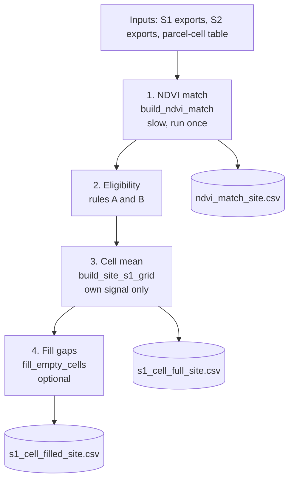
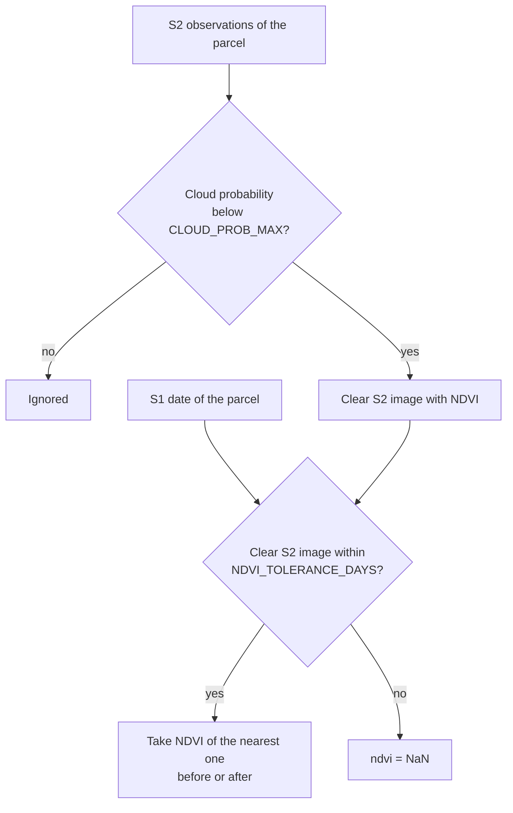
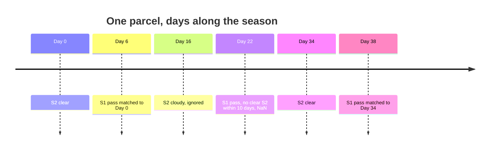
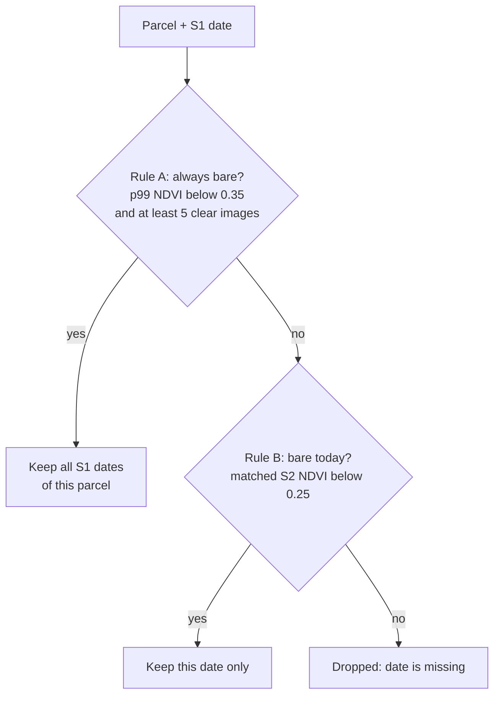
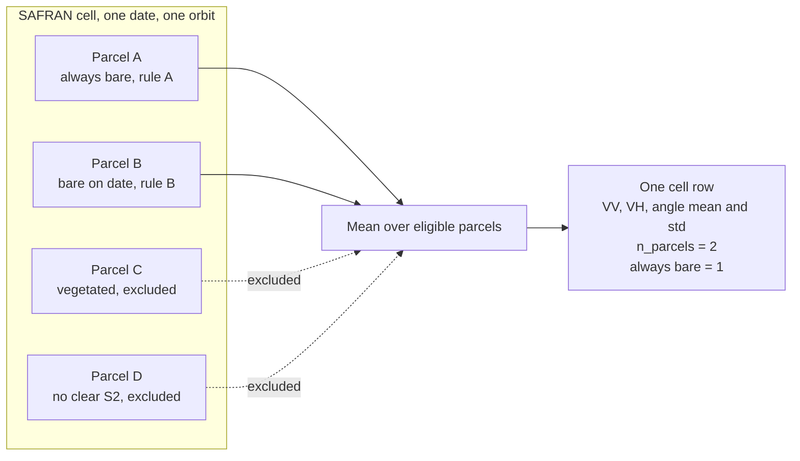
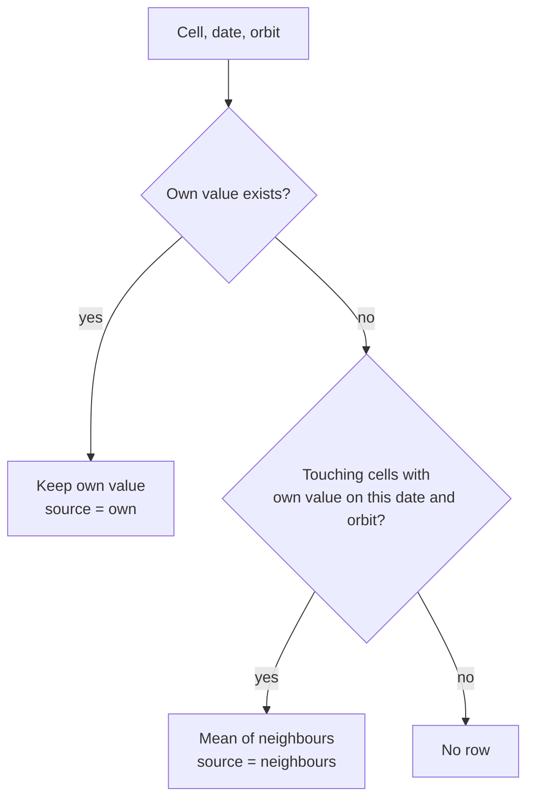

# Sentinel-1 bare-soil signal per SAFRAN cell

## 1. Purpose

`correspondance_grid_safran.py` and `grid_signal_aggregation.py` produce one mean
Sentinel-1 (S1) radar signal per SAFRAN cell, date and orbit, computed over
**bare-soil parcels only**, so the signal reflects soil moisture rather than canopy.

**Design principle:** a (parcel, S1 date) pair that does not qualify as bare is
simply absent. It is not an error and nothing is filled in at parcel level.
Cell aggregation happens afterwards, on whatever pairs survive.

## 2. Process overview

Run order: `correspondance_grid_safran.py`, then `build_ndvi_match()`,
`build_site_s1_grid()` and `fill_empty_cells()`.

The eligible pairs are not saved to disk. They are recomputed in step 3 from
`ndvi_match`, which is why changing thresholds is cheap.

## 3. Parameters a user changes

All are constants at the top of `grid_signal_aggregation.py`.

| Parameter | Default | Effect | Rerun from |
|---|---|---|---|
| `CLOUD_PROB_MAX` | 1 | Keeps S2 observations with `MSK_CLDPRB` below this value. At 1, only 0% cloud probability passes. | Step 1 |
| `NDVI_TOLERANCE_DAYS` | 10 | Maximum gap between an S1 date and the S2 image used for it. | Step 1 |
| `SEASON_MONTHS` | (4, 10) | Window used to judge whether a parcel is "always bare". | Step 2 |
| `SEASON_QUANTILE` | 0.99 | Robust "peak NDVI" for the season. | Step 2 |
| `MIN_S2_OBS` | 5 | Minimum clear images needed to trust rule A. | Step 2 |
| `ALWAYS_BARE_NDVI` | 0.35 | Rule A threshold. | Step 2 |
| `BARE_ON_DATE_NDVI` | 0.25 | Rule B threshold. | Step 2 |

Also edit the folder paths and site name in the `__main__` blocks. The site is
inferred from folder names (`region_<SITE>`, `S1_Exports_<SITE>`,
`S2_BANDS_Exports_<SITE>`).

## 4. S1 to S2 matching (step 1)

`match_s1_dates_to_ndvi()` works per parcel:

1. Keep clear S2 observations only (`MSK_CLDPRB < CLOUD_PROB_MAX`) and compute
   `ndvi = (B8 - B4) / (B8 + B4)`.
2. Take the unique (parcel, date) pairs from the S1 files. Only dates are used
   here, not VV/VH.
3. Match each S1 date to the **nearest clear S2 date** of the same parcel, before
   or after (`merge_asof`, `direction="nearest"`), only if the gap is at most
   `NDVI_TOLERANCE_DAYS`.
4. If none is within tolerance, `ndvi` is NaN. Seasonal statistics and the SAFRAN
   cell are then attached.

Example timeline for one parcel (S1 passes on top, S2 images below):

Two points to keep in mind:

- The matched S2 image is the nearest **clear** one, not necessarily the closest in
  time. A closer cloudy image is already filtered out.
- "Bare on the date" therefore means bare within roughly the tolerance window
  (about plus or minus 10 days), not on the exact day.

## 5. Eligibility rules (step 2)

A (parcel, S1 date) pair is kept if either rule admits it.

- **Rule A, always bare:** the parcel's seasonal NDVI percentile (p99 over
  April to October, stored as `ndvi_q99`) is below `ALWAYS_BARE_NDVI`, with at
  least `MIN_S2_OBS` clear images. All its S1 dates are kept. No date match needed.
- **Rule B, bare today:** the NDVI of the matched S2 image is below
  `BARE_ON_DATE_NDVI`. Only that date is kept. A NaN NDVI fails the test, so a pair
  with no nearby clear S2 can only qualify through rule A.

A pair that passes neither rule is dropped. This is the intended "missing date".

## 6. Cell aggregation (step 3)

`build_site_s1_grid()` merges the S1 rows with the eligible pairs and groups them
by `(cell, date, orbit_number, orbit_direction)`. Each group gives:

- `VV_mean`, `VH_mean`, `angle_mean`, and `VV_std`, `VH_std`
- `n_parcels`, `n_parcels_always_bare`, `n_parcels_bare_on_date`

The output contains the cell's **own** signal only. A cell has no row on a date
where none of its parcels qualified.

## 7. Optional gap filling (step 4)

`fill_empty_cells()` is a separate, cell-level step. Parcel eligibility is
unchanged. For every cell that contains parcels, on every (date, orbit) where the
cell has no own value:

- it takes the mean of the touching cells' own values (one ring, no recursion);
- it adds `source` (`own` or `neighbours`) and `n_neighbours` columns.

The filled file is a superset of the own-signal file. Filter on `source == "own"`
to keep strictly bare-soil values of the cell itself, or skip this step.

## 8. Outputs and rerun guide

Everything is written under `sites/site_<SITE>/`.

| Path | Content | Written by |
|---|---|---|
| `correspondance/correspondence_full_site_<SITE>.csv` | parcel to cell, per year | correspondence script |
| `ndvi/ndvi_match_site_<SITE>.csv` | per (parcel, S1 date): matched NDVI, seasonal stats, cell | step 1 |
| `s1_grid/s1_cell_<year>_site_<SITE>.csv`, `s1_cell_full_site_<SITE>.csv` | cell mean signal, own only | step 3 |
| `s1_grid/s1_cell_filled_site_<SITE>.csv` | own plus neighbour-filled | step 4 |

- After changing `CLOUD_PROB_MAX` or `NDVI_TOLERANCE_DAYS`: rerun from
  `build_ndvi_match()`.
- After changing season or NDVI thresholds: rerun only `build_site_s1_grid()`
  and `fill_empty_cells()`.

## 9. Notes for interpretation

- `CLOUD_PROB_MAX = 1` is very strict. It lowers the number of parcel dates that
  find a nearby S2 image and so the number that can qualify under rule B. Check the
  "no clear S2 within N days" percentage printed in step 1.
- Rule A depends only on seasonal statistics. Rule B depends on the date match. The
  output records only whether a pair was admitted by rule A (`is_always_bare`).
- The seasonal column is named `ndvi_q99` (from `SEASON_QUANTILE`). The docstring
  calls it `ndvi_q`.